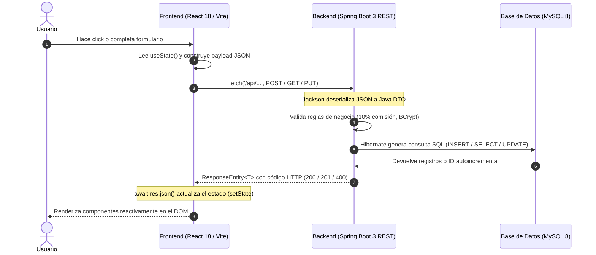

# Guía Maestra de Arquitectura y Defensa Oral
## Plataforma de Servicios y Oficios (Frontend ↔ Backend ↔ MySQL)

| Campo | Detalle Académico |
| :--- | :--- |
| **Materia** | Verificación y Validación de Programas / Proyecto de Software |
| **Docente** | Prof. Yamil Alvarez |
| **Integrantes** | Iris De Dominicis – Josué Chimbo |
| **Stack Técnico** | React 18 + Vite (SPA) \| Spring Boot 3 (Java 17/21) \| MySQL 8 Relacional |
| **Archivo Word Editable** | [GUIA_EXAMEN_ORAL_ARQUITECTURA_Y_FLUJO_APP.docx](file:///C:/Users/Admin/Desktop/PROYECTO_PLATAFORMA_SERVICIOS/GUIA_EXAMEN_ORAL_ARQUITECTURA_Y_FLUJO_APP.docx) |

---

## 1. Visión General del Proyecto

La plataforma es un marketplace vertical de contratación de oficios y servicios técnicos con dos pilares de monetización ética:
1. **10% de comisión sólo sobre la mano de obra:** Los materiales tienen 0% de recargo para garantizar precios transparentes.
2. **Suscripciones mensuales para Empresas:** Planes PyME ($12.000), Constructora ($28.000) y Corporativo ($55.000) para acceder a cuadrillas de trabajadores.
3. **Roles estrictos:** `ADMIN` (dueño), `ESPECIALISTA` (trabajador), `EMPRESA` (constructora) y `CLIENTE` (usuario final).

---

## 2. Arquitectura del Frontend (React 18 + Vite)

- **Componentes modulares:** `App.jsx`, `Sidebar.jsx`, `PublicacionCard.jsx`, modales de negocio (`PresupuestoModal.jsx`, `BilleteraModal.jsx`, `PlanesEmpresasModal.jsx`, `VerificacionModal.jsx`), páginas desacopladas (`Mensajes.jsx`, `Perfil.jsx`, `Login.jsx`).
- **Hooks nativos:** `useState` (estado local), `useEffect` (carga asíncrona), `useMemo` (filtrado de avisos por rubro y radio de distancia en memoria), `useNavigate` (rutas SPA).
- **Diseño Adaptativo PWA:** En celular se activa un Drawer deslizante con botón hamburguesa `☰` y una barra inferior táctil (*Dock*) al estilo de una app nativa de Android/iOS.
- **Proxy inverso de Vite:** `vite.config.js` mapea `/api` hacia `http://localhost:8085` para evitar errores de CORS.

---

## 3. Arquitectura del Backend (Spring Boot 3 + MySQL)

- **Arquitectura en 4 capas:**
  1. *Controladores REST (`@RestController`):* Deserializan peticiones JSON, validan DTOs y emiten códigos HTTP (`200`, `201`, `400`, `401`, `404`, `409`).
  2. *Servicios de Negocio (`@Service`):* Calculan el 10% de retención de plataforma, previenen votos duplicados y gestionan la lógica transaccional (`@Transactional`).
  3. *Repositorios (`@Repository`):* Interfaces que extienden `JpaRepository` con consultas derivadas automáticas.
  4. *Entidades JPA (`@Entity`):* Mapeo relacional con Hibernate hacia tablas de MySQL 8 (`usuarios`, `publicaciones`, `solicitudes_servicio`, `mensajes`, `empresas`, `perfiles`).
- **Seguridad Criptográfica:** Algoritmo **BCrypt** (`BCryptPasswordEncoder`) con salt aleatorio de 10 rondas para proteger contraseñas.

---

## 4. Ciclo de Comunicación (Frontend ↔ Backend)



---

## 5. Los 7 Flujos Principales con Pantallas Embebidas

````carousel

<!-- slide -->

<!-- slide -->

<!-- slide -->

<!-- slide -->

<!-- slide -->

<!-- slide -->

<!-- slide -->

<!-- slide -->

<!-- slide -->

````

---

## 6. Simulador de Examen Oral: Preguntas de la Mesa y Respuestas Modelo

1. **¿Cómo manejan el problema de CORS en desarrollo?**
   *Respuesta:* "Utilizamos el reverse proxy integrado en Vite (`vite.config.js`). Cuando React emite una llamada a `/api/...`, Vite la retransmite internamente a `http://localhost:8085`, de modo que el navegador percibe que cliente y servidor conviven en el mismo origen, eliminando bloqueos de CORS."
2. **¿Por qué la arquitectura REST es 'Stateless' (sin estado)?**
   *Respuesta:* "Porque el servidor Spring Boot no mantiene sesiones en memoria (`HttpSession`). Cada solicitud HTTP es autónoma y contiene toda la información necesaria para ser procesada. La sesión del usuario se persiste del lado del cliente mediante `localStorage`."
3. **¿Cómo protegen las contraseñas en MySQL?**
   *Respuesta:* "Mediante `BCryptPasswordEncoder`. Aplica una función hash unidireccional con salt aleatorio de 10 rondas. Las contraseñas nunca existen en texto plano, lo que previene vulnerabilidades de tablas arcoíris."
4. **¿Cómo garantizan que la comisión de Mercado Pago sea exacta?**
   *Respuesta:* "La regla del 10% se calcula estrictamente en el backend en `MercadoPagoControlador.java` (`comisionPlataforma10 = monto * 0.10` y `netoProfesional90 = monto * 0.90`) antes de generar la preferencia de pago, impidiendo cualquier manipulación desde JavaScript en el cliente."
5. **¿Qué códigos HTTP utilizan para reflejar los resultados?**
   *Respuesta:* "`200 OK` para consultas exitosas, `201 Created` para creaciones de recursos, `400 Bad Request` ante datos obligatorios faltantes, `401 Unauthorized` si falla la autenticación, `404 Not Found` si el ID no existe en MySQL, y `409 Conflict` ante colisiones de unicidad como correos o votos repetidos."
